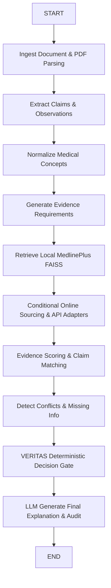

# VERITAS 3.0 — Comprehensive Project Documentation

## 1. Project Overview
**Purpose & Goals:** VERITAS 3.0 is an evidence-auditing decision intelligence engine designed for the medical domain. Its core goal is to move beyond standard RAG (Retrieval-Augmented Generation) and LLM chatbots that risk generating hallucinated or unsubstantiated medical advice. Instead, VERITAS enforces an evidence-first, deterministic paradigm. It analyzes clinical text, extracts claims, scores medical literature based on 5 quality dimensions, detects conflicts, checks for missing context, and strictly gates LLM output to ensure full traceability and empirical justification.

**Target Users:** Clinicians, medical researchers, and healthcare systems who require absolute traceability, transparency, and clinical reliability from AI tools.

**Current Status/Version:** Version 3.0. The system features a decoupled architecture with a FastAPI backend and a React SPA frontend.

## 2. Tech Stack
### Backend
- **Language:** Python 3.10+
- **Framework:** FastAPI (0.110.0+), Uvicorn (0.28.0+)
- **Pipeline Orchestration:** LangGraph (0.2.0+), Langchain Core (0.3.0+)
- **Database & ORM:** SQLite via SQLAlchemy (2.0.0+)
- **Vector Search & ML:** Sentence-transformers (2.7.0+), faiss-cpu (1.8.0+), NumPy (1.26.0+)
- **Auth:** python-jose[cryptography] (3.3.0+), passlib[bcrypt] (1.7.4+)
- **Utilities:** PyMuPDF (1.24.0+) for PDF parsing, lxml (5.1.0+) for XML ingestion, httpx (0.27.0+)
- **Testing:** Pytest (8.0.0+), pytest-asyncio (0.23.0+)

### Frontend
- **Framework:** React 19.2.8
- **Tooling:** Vite 8.3.0
- **Routing:** React Router DOM (7.18.4)
- **HTTP Client:** Axios (1.20.0)
- **Markdown Rendering:** react-markdown (10.1.0), remark-gfm (4.0.1)

### LLM Integrations
- **Primary Reasoner:** xAI Grok or Groq (`llama-3.3-70b-versatile`)
- **Fallback Reasoner:** Google Gemini (`gemini-1.5-flash`)

## 3. Repository Structure
```text
veritass-3.0/
├── backend/
│   ├── app/
│   │   ├── auth/                       # JWT auth logic
│   │   ├── evidence/                   # Rule-based decision gating & conflict detection logic
│   │   ├── graph/                      # LangGraph StateGraph pipeline (workflow.py)
│   │   ├── ingestion/                  # PDF & XML parsing scripts, claim extraction
│   │   ├── llm/                        # Orchestrator for Groq/Gemini/Fallback generation
│   │   ├── models/                     # SQLAlchemy ORM definitions
│   │   ├── normalization/              # Regex-based medical term standardizer
│   │   ├── retrieval/                  # FAISS local vector RAG orchestration
│   │   ├── routers/                    # REST API routes (auth.py, chats.py, account.py)
│   │   ├── schemas/                    # Pydantic data models (evidence.py, state.py)
│   │   ├── scoring/                    # VERITAS Evidence Quality heuristic evaluator
│   │   ├── sources/                    # API Adapters (FDA, WHO, CDC, NCBI, ClinicalTrials, MedlinePlus)
│   │   ├── utils/                      # Helper scripts (logger, caching)
│   │   ├── config.py                   # Pydantic BaseSettings for env vars
│   │   ├── database.py                 # SQLite setup and session management
│   │   └── main.py                     # FastAPI entry point
│   ├── tests/                          # Automated Pytest suite
│   └── requirements.txt                # Backend dependencies
├── frontend-react/
│   ├── src/
│   │   ├── api/                        # Axios wrapper for backend communication
│   │   ├── components/                 # React UI elements (Sidebar, EvidencePanel, ChatMessage, ChatInput)
│   │   ├── context/                    # React Context for Auth state
│   │   ├── pages/                      # ChatPage, LoginPage, AccountPage, RegisterPage
│   │   ├── App.jsx, main.jsx           # App entry points
│   │   └── index.css, App.css          # Styling
│   └── package.json
├── data/                               # Stored indices and demo documents
├── .env, .env.example                  # Environment configuration
├── run.sh, run_backend.sh, run_frontend.sh # Linux/macOS start scripts
└── run.bat, run_fullstack.bat          # Windows start scripts
```

## 4. Architecture & Design
VERITAS uses a decoupled monolithic design, with a Python-based intelligent backend API and a distinct React Frontend SPA. 
The core analytical engine is built around a **LangGraph State Machine** rather than simple procedural prompting. 

### LangGraph Workflow execution:

Instead of directly passing user inputs to the LLM, the system processes it deterministically via Python algorithms before hitting an LLM generation step, with strict deterministic fallbacks.

## 5. Core Modules & Components
- **`graph/workflow.py`:** The LangGraph definition (`veritas_graph`). Manages state progression from ingestion to LLM output.
- **`ingestion/`:**
  - `pdf_parser.py`: PyMuPDF logic for PDF text extraction.
  - `claim_extractor.py`: Extracts specific observations (vitals, meds) and clinical claims.
  - `xml_parser.py`: MedlinePlus XML ingestor.
- **`normalization/medical_norm.py`:** Standardizes disparate clinical terms into canonical representations.
- **`evidence/`:**
  - `decision_gate.py`: Forces system into one of 5 audited states.
  - `conflict_detector.py`: Flags disagreements among authoritative Tier 1 guidelines.
  - `missing_detector.py`: Evaluates clinical claims for missing necessary context (e.g., missing seated repeat reading for a blood pressure claim).
  - `matcher.py`: Correlates retrieved evidence fragments to the clinical claims.
- **`scoring/evaluator.py`:** Computes the VERITAS 5-dimension quality score out of 100.
- **`retrieval/local_rag.py` & `vector_store.py`:** Manages local, privacy-first FAISS vector lookups.
- **`sources/router.py` & adapters:** Smart routing logic (e.g. routing "blood_pressure" to WHO and "metformin" to FDA) and specific API adapters for external medical authorities.
- **`llm/orchestrator.py`:** Synthesizes the finalized audit report using Groq, with an automatic Google Gemini fallback, or purely deterministic string generation if all LLMs fail.
- **Frontend Components:**
  - `EvidencePanel.jsx`: Visualizes scores, authority labels, and verdict badges.
  - `ChatMessage.jsx`: Renders markdown sanitized of internal system tags (`[EV-001]`).

## 6. Data Models & Schema
### SQLAlchemy ORM Models (`backend/app/models/__init__.py`)
- **`User`:** `id`, `email`, `name`, `password_hash`, `is_active`, `created_at`, `updated_at`.
- **`Conversation`:** `id`, `user_id` (FK), `title`, `created_at`, `updated_at`.
- **`Message`:** `id`, `conversation_id` (FK), `role` (user/assistant/system), `content`, `veritas_result_json` (serialized evidence graph audit), `created_at`.
- **`Attachment`:** `id`, `conversation_id` (FK), `message_id` (FK), `filename`, `file_type`, `mime_type`, `file_size`, `storage_path`.

### TypedDict State & Pydantic Schemas (`backend/app/schemas/`)
- **`DecisionState`:** The full TypedDict passed through the LangGraph workflow holding all intermediate extracted claims, evidence, scorings, and final explanation strings.
- **`Observation` & `Claim`:** Track quantitative/qualitative findings and stated clinical inferences.
- **`EvidenceItem`:** Houses standard citation data (e.g. `EV-001`), the text snippet, source name, authority tier (1-5), and a composite `evidence_score`.
- **`Contradiction` & `MissingInfoItem`:** Represent flagged contradictions and missing context elements.
- **`DecisionResponse`:** The monolithic schema served over the `/api/analyze` REST endpoint combining all observations, claims, evidences, graph links, and audit logs.

## 7. API Reference
- **Auth:**
  - `POST /api/auth/register` - Registers new user, returns JWT.
  - `POST /api/auth/login` - Authenticates user, returns JWT.
  - `GET /api/auth/me` - Validates JWT and returns current user info.
- **Account:**
  - `GET /api/account/me` - Profile view.
  - `PATCH /api/account/me` - Name updates.
- **Chats & Messages:**
  - `POST /api/chats` - Initializes new conversation.
  - `GET /api/chats` - Retrieves user's conversations.
  - `GET /api/chats/{chat_id}` - Detailed view with message history.
  - `PATCH /api/chats/{chat_id}`, `DELETE /api/chats/{chat_id}`.
  - `POST /api/chats/{chat_id}/attachments` - Uploads a PDF or text attachment to a specific conversation.
  - `POST /api/chats/{chat_id}/messages` - The core endpoint; triggers the `veritas_graph` LangGraph pipeline and persists the assistant's audited result to DB.
  - `GET /api/chats/{chat_id}/messages/{message_id}/veritas` - Fetches the raw stored JSON payload `veritas_result_json` for debugging/UI graph rendering.
- **System:**
  - `GET /api/health` - Healthcheck.
  - `POST /api/analyze` - Legacy standalone analysis invocation.
  - `POST /api/upload` - Legacy standalone upload endpoint.
  - `POST /api/index/medlineplus` - Indexes MedlinePlus XML into FAISS.

## 8. State Management
- **Backend:** State is managed immutably at the execution level via the LangGraph `DecisionState`.
- **Frontend:** State is managed via standard React patterns. Authentication state is globally wrapped inside `AuthContext`. Complex chat states and conversation lists are stored in local component-level state variables in `ChatPage.jsx`.
- **Persistence:** All chats and serialized decision trails (`veritas_result_json`) are stored within SQLite (`veritas.db`).

## 9. Authentication & Authorization
- **Implementation:** Stateless JWT (JSON Web Tokens).
- **Security:** Passwords are hashed using `passlib[bcrypt]`.
- **Flow:** Users authenticate at `/api/auth/login` receiving an access token, which is subsequently passed as a `Bearer` token in the `Authorization` header by the Axios API client for all subsequent protected routes. Backend `get_current_user` dependency enforces authorization rules.

## 10. Configuration & Environment
Environment variables govern API connectivity, storage paths, and reasoning models. They are outlined in `.env.example`:
- **Auth/Crypto:** `SECRET_KEY`, `ACCESS_TOKEN_EXPIRE_MINUTES`.
- **LLM APIs:** `GROQ_API_KEY`, `GROQ_MODEL`, `GROQ_BASE_URL`, `GEMINI_API_KEY`, `GEMINI_MODEL`, `GOOGLE_API_KEY`.
- **Source APIs:** `WHO_API_BASE_URL`, `FDA_API_KEY`, `FDA_API_BASE_URL`.
- **Storage:** `MEDLINEPLUS_XML_PATH`, `CHROMA_PERSIST_DIRECTORY` (Note: the project uses FAISS), `CACHE_EXPIRY_HOURS`.
- **App Configuration:** `DEBUG`, `PORT`, `HOST`.

## 11. Build & Dev Workflow
1. **Virtual Environment Setup:** `python3 -m venv venv` and `source venv/bin/activate`.
2. **Install Dependencies:** `pip install -r backend/requirements.txt` and `npm install` inside `frontend-react`.
3. **Execution Scripts:** The root of the repository provides launch scripts. 
   - Linux/Mac: `./run.sh` (Full stack concurrent), `./run_backend.sh`, `./run_frontend.sh`.
   - Windows: `run_fullstack.bat`, `run.bat`.
   - Ensure `.env` is configured prior to running.
4. **Ports:** Frontend Vite server runs on `5173`, Backend API runs on `8000`.

## 12. Testing
- **Framework:** Pytest configured via `pytest.ini`. 
- **Command:** `PYTHONPATH=backend python -m pytest backend/tests/ -v`.
- **Coverage:** The test suite covers logic endpoints, conflict detection logic, decision gating bounds, automated XML/PDF parsing edge cases, scoring formulae tests, and deterministic LLM failover. Currently registers 25 passing test cases.

## 13. External Integrations & Services
- **Groq API / xAI Grok:** Primary rapid reasoning inference layer utilizing models like `llama-3.3-70b-versatile`.
- **Google Gemini API:** Primary fallback mechanism configured via `gemini-1.5-flash` for high-throughput resilience. 
- **WHO GHO OData:** World Health Organization data sources API.
- **openFDA API:** Extracts medication labeling and adverse reaction data.
- **CDC Open Data SODA:** Communicable disease controls and prevention literature.
- **MedlinePlus (NLM):** Patient-level baseline medical authority context ingested via local XML parsing and online fetch.
- **NCBI PubMed E-utilities:** For Tier 2 academic literature references.
- **ClinicalTrials.gov:** For trial-specific investigational data.
- **NLM Clinical Tables:** FHIR / ICD-10 standardized ontology fetching.

## 14. Key Algorithms & Business Logic
### VERITAS Evidence Quality Scoring (5 Dimensions)
Evaluates any retrieved evidence chunk out of 100:
`Score = (0.30 * Authority + 0.25 * Relevance + 0.15 * Recency + 0.15 * Methodology + 0.15 * Traceability) * 100`
- **Authority Tiers:** Range from Tier 1 (Gov/Global Org = 0.98 multiplier) down to Tier 5 (Unverified = 0.15 multiplier).
- **Labels:** HIGH ($\ge 85$), MODERATE ($65-84.9$), LOW ($50-64.9$), QUESTIONABLE ($<50$).

### Deterministic Decision Gate (5 Audited States)
Forces the conclusion into strict boundaries regardless of LLM generation:
1. `SUPPORTED`
2. `CONFLICTING` (Explicit disagreements between top tier sources)
3. `ADDITIONAL_INFORMATION_REQUIRED` (Missing vital context variables detected)
4. `QUESTIONABLE` (Only low-tier/weak evidence retrieved)
5. `NO_RELIABLE_CONCLUSION`

## 15. Known Issues, TODOs & Tech Debt
- **Frontend Refinements:** Noted in `plan.md` that some rich UI elements present in the legacy HTML front-end (like the SVG radial graph and observation grid) have yet to be fully migrated to the React `EvidencePanel.jsx`.
- **System Prompt Tags:** The LLM prompt occasionally bleeds `[EV-001]` tags into the chat UI which need aggressive sanitization within React's `ChatMessage` component.
- **Database Bloat:** The full serialized LangGraph snapshot is saved in `Message.veritas_result_json` for every assistant query. Over time on a high-throughput system, SQLite will encounter bloat.
- **Infrastructure:** The system heavily utilizes local file-path relative indices. For production, the database needs to migrate from SQLite to PostgreSQL, and the repository requires Dockerization (`Dockerfile` / `docker-compose.yml`) for seamless deployment.

## 16. Changelog / Git History Summary
- The codebase embodies the initial development integration phase of VERITAS 3.0. Recent commits entail the integration of the React frontend rewrite and the incorporation of LangGraph logic over the previous procedural LLM chaining models. The primary architectural pivot reflects the introduction of stateless JWT authentication and a new database schema mapping users to conversational sessions.
