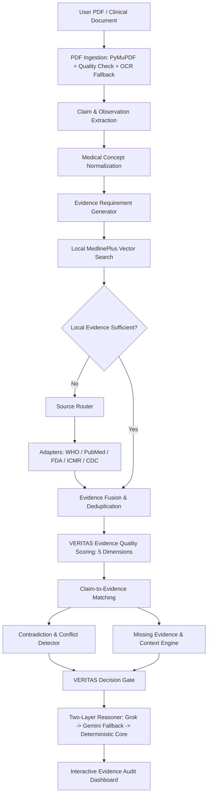

# VERITAS — Evidence-Aware Decision Intelligence System

[](https://www.python.org/)
[](https://fastapi.tiangolo.com/)
[](https://github.com/langchain-ai/langgraph)
[]()

> **VERITAS is NOT a chatbot.** It does not simply retrieve documents and ask an LLM to generate an answer. It is an **evidence-auditing decision intelligence engine** that determines whether a medical conclusion is empirically and clinically justified by authoritative medical evidence.

---

## 🏛️ Core Philosophy & Innovation

Standard medical AI tools summarize documents or generate advice directly via LLMs, risking hallucinations and unsubstantiated conclusions.

**VERITAS** inverts this paradigm:
1. **Evidence First, LLM Second**: 80%+ of workflow execution happens via deterministic Python algorithms (local TF-IDF vector retrieval, NLM XML parsing, rule-based clinical normalization, multi-dimensional source scoring, conflict detection, and deterministic decision gates).
2. **Strict Provenance & Traceability**: Every observation and statement is linked to an evidence item citation (`[EV-001]`, `[EV-002]`), authority tier, publication date, and URI.
3. **Contradiction Transparency**: Never picks an arbitrary winner when top guidelines diverge; instead, compares guideline differences side-by-side and analyzes the root cause (e.g. ACC/AHA vs ESC hypertension cutoffs).
4. **Missing Context Engine**: Explicitly identifies mandatory clinical parameters (e.g. repeat seated measurements, symptoms, medications) before allowing a diagnostic conclusion.
5. **Primary Grok / Gemini Fallback**: Uses xAI Grok for high-speed semantic synthesis with automatic fallback to Gemini on timeout, rate-limit, or failure.

---

## 🔬 System Architecture & Workflow



---

## 📊 VERITAS Evidence Quality Scoring (5 Dimensions)

The **VERITAS Evidence Quality Score** (0–100) is a transparent composite heuristic:

$$\text{Evidence Score} = \left(0.30 \cdot \text{Authority} + 0.25 \cdot \text{Relevance} + 0.15 \cdot \text{Recency} + 0.15 \cdot \text{Methodology} + 0.15 \cdot \text{Traceability}\right) \times 100$$

### 1. Authority Tiers
- **Tier 1 (0.98)**: Official government / international organizations (WHO, MedlinePlus/NLM, FDA, ICMR, CDC).
- **Tier 2 (0.90)**: Peer-reviewed indexed biomedical literature (PubMed, Lancet, NEJM).
- **Tier 3 (0.78)**: Academic medical centers and university research institutions.
- **Tier 4 (0.45)**: General commercial websites and blogs.
- **Tier 5 (0.15)**: Unverifiable / user-generated content.

### 2. Quality Labels
- **HIGH**: $\ge 85.0$
- **MODERATE**: $65.0 - 84.9$
- **LOW**: $50.0 - 64.9$
- **QUESTIONABLE**: $< 50.0$

---

## 🚪 Deterministic Decision Gate

The Decision Gate outputs one of five audited states:

| Status | Trigger Condition | Escalation |
|---|---|---|
| `SUPPORTED` | Strong Tier 1-2 evidence ($\ge 65.0$), no major contradictions, critical context complete | None (`human_review_required = false`) |
| `CONFLICTING` | Authoritative sources materially disagree on clinical criteria or recommendations | `human_review_required = true` |
| `ADDITIONAL_INFORMATION_REQUIRED` | Essential clinical context missing (e.g., repeat reading, symptoms, medication list) | `human_review_required = true` |
| `QUESTIONABLE` | Evidence is weak, unverified, or scores below minimum quality threshold ($< 50.0$) | `human_review_required = true` |
| `NO_RELIABLE_CONCLUSION` | Insufficient data to justify a defensible clinical conclusion | `human_review_required = true` |

---

## 📁 Project Structure

- `backend/` - FastAPI backend application (runs with `PYTHONPATH=backend`).
- `frontend-react/` - Active frontend built with React and Vite.
- `frontend/` - Legacy flat HTML/CSS/JS frontend (kept for reference).
- `venv/` - Python virtual environment (at project root).
- `run.sh`, `run_backend.sh`, `run_frontend.sh` - Linux/macOS launch scripts.
- `run.bat`, `run_fullstack.bat` - Windows launch scripts.

---

## ⚡ Quick Start & Installation

### 1. Clone & Setup Environment
```bash
git clone <repository_url>
cd veritass-3.0
python3 -m venv venv
source venv/bin/activate  # On Windows: venv\Scripts\activate
```

### 2. Install Dependencies
```bash
pip install -r backend/requirements.txt
```

### 3. Configure Environment Variables (`.env`)
Create `.env` or edit the existing file:
```env
# ---- Chat Authentication & Persistence ----
SECRET_KEY=your_jwt_secret_key
ACCESS_TOKEN_EXPIRE_MINUTES=10080

# ---- Primary Reasoning Engine: Groq ----
GROQ_API_KEY=your_groq_api_key
GROQ_MODEL=llama-3.3-70b-versatile
GROQ_BASE_URL=https://api.groq.com/openai/v1

# ---- Fallback Reasoning Engine: Google Gemini ----
GEMINI_API_KEY=your_gemini_api_key
GEMINI_MODEL=gemini-1.5-flash

# ---- Local MedlinePlus XML Ingestion ----
MEDLINEPLUS_XML_PATH=data/medlineplus/raw/mplus_topics.xml

# ---- Authoritative Source Endpoints ----
WHO_API_BASE_URL=https://ghoapi.azureedge.net/api
FDA_API_KEY=your_fda_api_key
FDA_API_BASE_URL=https://api.fda.gov

# ---- Vector Index & Persistence ----
CHROMA_PERSIST_DIRECTORY=data/medlineplus/index
CACHE_EXPIRY_HOURS=72

# ---- Application Settings ----
DEBUG=False
PORT=8000
HOST=0.0.0.0
```

### 4. Run the Project
The easiest way to run the project is using the provided scripts at the project root, which automatically handle virtual environment activation and set `PYTHONPATH=backend`.

**Linux / macOS:**
```bash
# Full stack (backend + frontend together)
./run.sh

# Backend only
./run_backend.sh

# Frontend only
./run_frontend.sh
```

**Windows:**
```cmd
:: Full stack (backend + frontend together)
run_fullstack.bat

:: Backend only
run.bat
```

Once running, the services are available at:
- **Frontend (React)**: http://localhost:5173
- **Backend API**: http://localhost:8000
- **API Docs (Swagger)**: http://localhost:8000/docs

---

## 🧪 Automated Test Suite (25 Tests)

Run the full automated test suite covering all modules, XML parsers, PDF extractors, scoring logic, conflict detectors, and demo scenarios. Run this from the project root with the correct `PYTHONPATH`:

```bash
PYTHONPATH=backend python -m pytest backend/tests/ -v
```

Output:
```text
backend/tests/test_api_endpoints.py::test_health_endpoint PASSED
backend/tests/test_api_endpoints.py::test_fixtures_endpoint PASSED
backend/tests/test_api_endpoints.py::test_analyze_endpoint PASSED
backend/tests/test_conflict_and_missing.py::test_conflict_detection PASSED
backend/tests/test_conflict_and_missing.py::test_missing_evidence_detection PASSED
backend/tests/test_decision_gate.py::test_decision_gate_supported PASSED
backend/tests/test_decision_gate.py::test_decision_gate_conflicting PASSED
backend/tests/test_decision_gate.py::test_decision_gate_additional_info_required PASSED
backend/tests/test_decision_gate.py::test_decision_gate_questionable PASSED
backend/tests/test_decision_gate.py::test_decision_gate_no_reliable_conclusion PASSED
backend/tests/test_demo_cases.py::test_demo_1_supported_case PASSED
backend/tests/test_demo_cases.py::test_demo_2_conflicting_case PASSED
backend/tests/test_demo_cases.py::test_demo_3_incomplete_case PASSED
backend/tests/test_demo_cases.py::test_demo_4_questionable_case PASSED
backend/tests/test_demo_cases.py::test_demo_5_no_reliable_conclusion_case PASSED
backend/tests/test_llm_fallback.py::test_llm_orchestrator_deterministic_fallback PASSED
backend/tests/test_pdf_parser.py::test_pdf_extraction_basic PASSED
backend/tests/test_pdf_parser.py::test_pdf_section_detection PASSED
backend/tests/test_pdf_parser.py::test_pdf_nonexistent_file PASSED
backend/tests/test_scoring.py::test_veritas_scoring_formula PASSED
backend/tests/test_scoring.py::test_veritas_scoring_low_authority PASSED
backend/tests/test_scoring.py::test_overall_breakdown_aggregation PASSED
backend/tests/test_xml_parser.py::test_xml_parser_valid_file PASSED
backend/tests/test_xml_parser.py::test_xml_parser_lenient_regex_fallback PASSED
backend/tests/test_xml_parser.py::test_xml_parser_nonexistent PASSED
============================= 25 passed in 5.84s ==============================
```

---

## 🎯 Preloaded Hackathon Demo Cases

1. **Demo 1 — SUPPORTED**: Standard adult blood pressure reading (118/76 mmHg) corroborated against MedlinePlus & WHO.
2. **Demo 2 — CONFLICTING**: Blood pressure (134/84 mmHg) evaluated against ACC/AHA 2017 criteria (Stage 1 Hypertension $\ge 130/80$) vs European ESC/ESH criteria ($\ge 140/90$).
3. **Demo 3 — INCOMPLETE**: Isolated hypotension reading (85/55 mmHg) lacking seated repeat reading, symptoms, and hydration/medication status.
4. **Demo 4 — QUESTIONABLE**: Unverified blog claiming celery juice cures hypertension within 48 hours without prescription drugs.
5. **Demo 5 — NO RELIABLE CONCLUSION**: Hemolyzed specimen fragment with uninterpretable values.

---

## 🔒 Privacy & Safety Notice
VERITAS processes PDF documents locally and sends only minimal extracted clinical claims to reasoning models. VERITAS is a clinical decision-support and evidence-auditing intelligence tool; it does not replace professional medical judgment or licensed emergency clinical triage.
