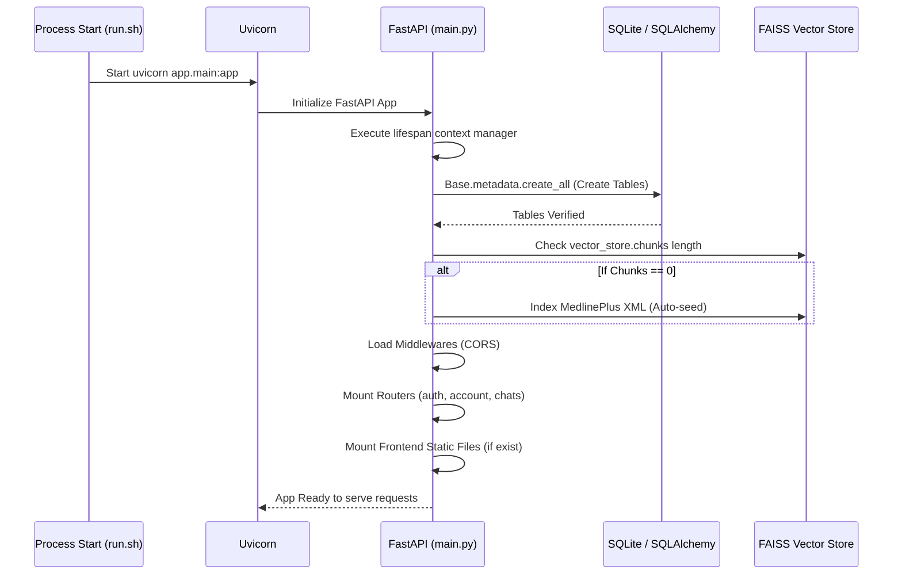
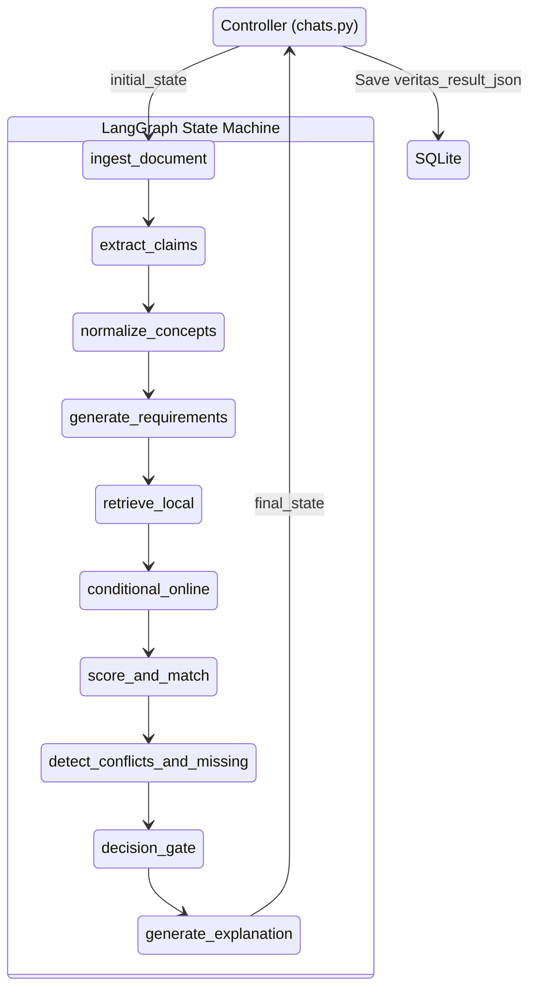
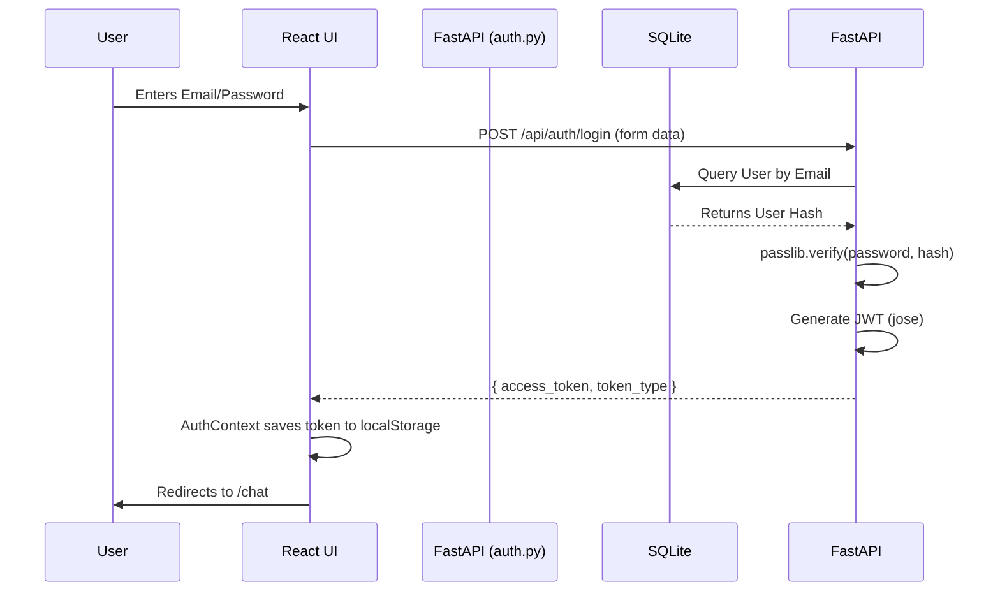

# VERITAS 3.0 Comprehensive Workflow Documentation

This document exhaustively details every core workflow in the VERITAS 3.0 ecosystem. It covers development, building, runtime execution, data pipelines, authentication, testing, and CI/CD. 

---

## 1. Development Workflow

### Local Setup from Scratch
1. **Repository Clone & Directory Entry:** `cd /home/yashraj/repos/veritass-3.0`
2. **Environment Configuration:** 
   - Copy `.env.example` to `.env`.
   - Populate secrets: `SECRET_KEY`, `GROQ_API_KEY`, `GEMINI_API_KEY`, etc.
3. **Backend Setup:**
   - Create Python Virtual Environment: `python3 -m venv venv`
   - Activate: `source venv/bin/activate` (or `venv\Scripts\activate` on Windows).
   - Install Dependencies: `pip install -r backend/requirements.txt`
4. **Frontend Setup:**
   - Navigate to frontend: `cd frontend-react`
   - Install Node Modules: `npm install`
5. **Execution:**
   - Run the full stack locally: `./run.sh` (Linux/Mac) or `run_fullstack.bat` (Windows).
   - This fires up Uvicorn (Backend on `:8000`) and Vite (Frontend on `:5173`) concurrently.

### Branch Strategy, Commits, and Code Review
- **Current State:** The project is optimized for local prototyping and does not explicitly enforce a branching strategy in the codebase configurations.
- **Hooks & Linters:** There are no active `husky` pre-commit hooks. However, `oxlint` is configured in `frontend-react/package.json` for manual linting (`npm run lint`).
- **PR Process:** Operates on standard GitHub Flow/Trunk-based development implicitly.

---

## 2. Build & Compilation Workflow

### Backend Build
- **No Compilation Step:** Python is interpreted. The backend relies entirely on Uvicorn acting as an ASGI server for the FastAPI application. No build output is generated; it runs directly from source.

### Frontend Build Pipeline
- **Bundler:** Vite 8.3.0
- **Step-by-step:**
  1. `npm run build` triggers `vite build`.
  2. Vite uses `esbuild` internally to transpile React (JSX) and modern JavaScript down to browser-compatible JS.
  3. CSS is minified and bundled.
  4. **Output Structure:** The compiled static assets (HTML, JS, CSS, public assets) are emitted to `frontend-react/dist/`.
- **Environment Builds:** Managed by Vite's environment variable system (`.env` files parsed during build) and backend config (`app/config.py`).

---

## 3. Runtime Workflow

### App Bootstrap Sequence (Backend)

### Request/Response Lifecycle (Chat Pipeline)
1. Request hits `POST /api/chats/{chat_id}/messages`.
2. **Auth Layer:** `get_current_user` dependency validates JWT.
3. **Database Layer:** User message is persisted to SQLite via SQLAlchemy session.
4. **Processing:** Controller delegates payload to `veritas_graph.ainvoke(initial_state)`.
5. **Response:** Graph resolves to a `DecisionResponse`. Assistant message and serialized graph state (`veritas_result_json`) are saved to DB. JSON is returned to client.

### Background Jobs & Cron Tasks
- **None:** The architecture is entirely synchronous/async-await driven. There are no persistent celery workers, Redis queues, or cron jobs. Long-running tasks (like PDF parsing and API lookups) block the specific HTTP request via `asyncio`.

---

## 4. Data Flow Workflow (LangGraph Engine)

The core data pipeline of the application resides in `backend/app/graph/workflow.py`.

- **Validation:** Enforced via Pydantic schemas throughout the state transitions (`schemas/state.py`).
- **State Flow:** Data flows continuously as a mutated `DecisionState` TypedDict.
- **Caching Layer:** Local FAISS vector store holds MedlinePlus embeddings in-memory (or local disk). External API results are not actively cached via Redis.

---

## 5. Authentication & Session Workflow

### Login & Session Flow

- **Protected Routes:** `axiosInstance.js` automatically intercepts requests and attaches the `Bearer {token}` header.
- **Logout:** Handled client-side by purging the token from storage and clearing React Context state.

---

## 6. Frontend State Management Workflow

- **Global Auth State:** Managed via `AuthContext.jsx`. Wraps the app and provides `user`, `token`, and `logout()` globally.
- **Local View State:** Page-level state (`ChatPage.jsx`) handles conversation lists, active chat messages, and loading indicators using React `useState` and `useEffect`.
- **Syncing:** Component fetches data via Axios wrapper (`src/api`), updates local state array `setMessages()`, triggering React DOM re-renders.

---

## 7. Testing Workflow

- **Test Suite:** Built with `pytest` and `pytest-asyncio`. Housed in `backend/tests/`.
- **Execution:** `PYTHONPATH=backend python -m pytest backend/tests/ -v`.
- **Coverage:** Contains tests for:
  - API Endpoints (`test_api_endpoints.py`, `test_chat_auth.py`).
  - Logic engines (`test_conflict_and_missing.py`, `test_decision_gate.py`, `test_scoring.py`).
  - LangGraph regression and LLM failover (`test_rag_regression.py`, `test_llm_fallback.py`).
- **Data Setup:** Uses isolated SQLite test DBs and mock JSON fixtures (`demo_cases.json`). Mocking is applied heavily to external API adapters and Groq LLM responses to ensure deterministic testing.

---

## 8. CI/CD Workflow

- **Current Architecture:** Exclusively designed for local iteration.
- **Pipeline:** There are **no CI/CD pipelines**, GitHub Actions, or deployment scripts (like Terraform or Dockerfiles) present. 
- **Recommendation:** A future production deployment requires Dockerizing the FastAPI and Vite apps, and moving SQLite to PostgreSQL.

---

## 9. Error Handling Workflow

- **Backend Layer:** 
  - Standard errors bubble up to FastAPI controllers and are caught, raising `HTTPException` (400, 404, 500).
  - In `chats.py`, if `veritas_graph.ainvoke()` fails, a try/except block catches the `Exception`, logs it, and persists an Assistant message in the DB stating *"I encountered an error processing your request."* to prevent dangling UI states.
- **LLM Failover:** Handled inside `LLMOrchestrator`. If Groq fails -> tries Gemini -> if Gemini fails -> returns hardcoded deterministic string.
- **Logging:** Python `logging` module captures errors and stdout.
- **Frontend Layer:** Axios interceptors catch 401s (triggering logout) or map 500s to user-facing toast notifications.

---

## 10. Third-Party Integration Workflows

For external medical APIs (WHO, FDA, CDC, MedlinePlus, NCBI, ClinicalTrials):
- **Invocation:** Dispatched concurrently in `conditional_online` node via HTTP clients (`httpx`).
- **Routing:** Governed by `SourceRouter`. If a user asks about "metformin" (medication), it triggers the FDA adapter. If they ask about "blood pressure" (vital), it triggers WHO/CDC.
- **Failure Handling:** Wrapped in `try/except` in `workflow.py`. If an external source times out, its ID is added to `sources_failed` in the audit log, and the pipeline continues gracefully with whatever evidence it managed to retrieve.

---

## 11. Database Workflow

- **ORM:** SQLAlchemy Core + Declarative Base.
- **Database Engine:** SQLite (stored at `backend/data/veritas.db`).
- **Connection pooling:** SQLite is configured with `check_same_thread: False` to support FastAPI's asynchronous multi-threading model.
- **Schema Migrations:** No migration tool (like Alembic) is used. Schemas are constructed via `Base.metadata.create_all(bind=engine)` upon application boot. Altering existing schemas requires manually dropping tables or destroying the `veritas.db` file.
- **Seeding:** The FAISS vector database is automatically seeded with XML data on app startup if empty.

--- 
*Generated by VERITAS 3.0 System Audit.*
